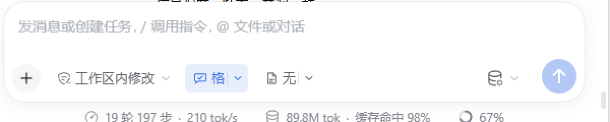

# dsh-output-style — 输出风格（基调 + 产出双分体控件 + 预设管理）

> Two split composer controls for [DeepSeek Harness](https://github.com/deepseek-ai/deepseek-harness): each pairs an on/off switch with its own preset menu — one for the communication tone, one for the output form; each session's system prompt follows the selections, with a settings page for the preset library.

DSH 输入框里有两个**分体控件**（开关 + 菜单），作用域都是**当前会话**：


- **`[格赖斯·高效 | ▾]`**：主按钮是**基调开关**（单击开/关；按钮文字显示当前基调），小三角打开**沟通基调**菜单。
- **`[无额外要求 | ▾]`**：主按钮是**产出开关**（单击开/关；按钮文字显示当前产出预设），小三角打开**产出形态**菜单。
- 两开关互相独立；任一菜单选中一项即生效，并自动打开**它自己的**开关。每组展示置顶前 5 条 + **「更多…」**（展开全部）。
- 输入框变窄时两个控件会自动收缩为**首字**（如「格」「无」），保持工具栏单行不换行：



| 沟通基调菜单 | 产出形态菜单 |
|---|---|
|  |  |

## 预设

- 内置 **7 个沟通/思考基调**：格赖斯·高效、教练引导、严谨审阅、创意发散、极简结论、苏格拉底追问、均衡自然。
- 内置 **7 个产出形态**：代码实现、数据分析、文档写作、翻译、总结提炼、教学解释、方案对比。
- **预设就是 Markdown 文件**，放在 `<DSH_HOME>/output-style/presets/tone/*.md` 与 `.../presets/output/*.md`；插件用 `fs.watch` 热重载，改文件即生效：
  ```markdown
  ---
  name: "家庭风格"
  pinned: true
  ---
  先给结论，再给依据……
  ```
- 菜单每组显示置顶的前 5 条 + **「更多…」**（展开全部）。
- **设置 → 输出风格**：两个 tab 管理预设 —— 新增、编辑、删除、置顶（前 5 条）、恢复默认；底层直接读写上面的 Markdown 文件；单条提示词上限 2000 字符。
- 内置预设也以文件形式存在，可改可删；「恢复默认」会重写该分类的出厂文件。

## 提示词注入

三个独立 section，按顺序追加到系统提示词：

```
deployment:persona-prefix
style:policy   (order 650)  ← 基调开关开、基调为默认（格赖斯）时注入内置格赖斯准则
style:tone     (order 650)  ← 选了具体基调时注入该基调提示词（替换 policy）
style:output   (order 660)  ← 产出开关开、且选了产出形态时注入该提示词
```

- 两个开关分别控制自己的 section：基调关 → policy/tone 为空；产出关 → output 为空。
- 每个 step 的 assembly 都会重新求值，**切换后同一轮的下一个 step 就生效**，不需要新会话。
- 状态按 Session 存进 DSH 官方的 **storage domain**（`output_style_pair`），浏览器通过 **session projection**（`outputStylePair`）订阅，不再有自定义 HTTP 状态接口和轮询：
  - 持久化：`<DSH_HOME>/storages/output_style_pair.json`（由 DSH 存储后端管理）
  - 浏览器写入：执行 `/style` 命令（与键盘操作同一条 `command/run`→`command/done` 生命周期）
- 删除正在使用的预设 → 该会话自动回退（基调回内置格赖斯、产出回无），不会报错。

## 使用

- 单击两个主按钮分别开关「基调」「产出」；各自的小三角选预设，选中即生效并自动打开对应开关。
- 斜杠命令 `/style`：
  - `/style` 或 `/style status` — 查看两个开关、基调、产出
  - `/style on` / `/style off` — 基调开关
  - `/style output on` / `/style output off` — 产出开关
  - `/style tone <id>`、`/style output <id>`；`/style tone none`、`/style output none` 恢复默认
- 内置 id：基调 `grice` `coach` `audit` `creative` `minimal` `socratic` `balanced`；产出 `code` `analysis` `doc` `translate` `summary` `tutorial` `options`。

## 安装

要求：DSH 0.2.x（在 `0.2.1-rc.5` 桌面版实测），无需构建步骤（纯 JS，无 `prepare` 脚本）。

### 方式一：从 GitHub 安装（推荐）

```powershell
dsh plugin --profile <你的 profile> add github:GinoXiang/dsh-output-style
```

`dsh plugin` 会自动把 `dsh-output-style` 加进该 profile 的 `dsh.profile.bundles`。
开启 HMR 的 DSH 无需重启、约 1–3 秒内生效；未开启 HMR 时重启 DSH 并刷新页面。

### 方式二：本地开发安装

```powershell
git clone https://github.com/GinoXiang/dsh-output-style.git
dsh plugin --profile <你的 profile> add link:<仓库绝对路径>
```

Windows 且路径含空格时，pnpm 的 `link:` spec 容易出问题，可先用目录联接换成无空格路径：

```powershell
New-Item -ItemType Junction -Path "$env:USERPROFILE\plugins\dsh-output-style" -Target "<仓库绝对路径>"
dsh plugin --profile <你的 profile> add "link:C:/Users/<you>/plugins/dsh-output-style"
```

### 升级到 0.4.0（状态架构 + Markdown 预设）

0.4.0 起会话状态改存 DSH 官方 storage domain，预设改存 Markdown 文件；旧数据**首次启动自动迁移**：

- `<DSH_HOME>/output-style/state.json` → 存储域 `output_style_pair`（旧文件重命名为 `state.json.migrated`）
- `<DSH_HOME>/output-style/presets.json` → `<DSH_HOME>/output-style/presets/{tone,output}/*.md`（旧文件重命名为 `presets.json.migrated`）
- 预设目录可随时用任意编辑器改，插件热重载；`/style` 命令与设置页行为不变
- 浏览器端不再轮询：旧页面需要刷新一次（HMR 会自动重载 client bundle）

### 从旧名 `dsh-grice` 升级

插件在 0.3.0 改名为 `dsh-output-style`。旧状态目录 `<DSH_HOME>/grice/` 会在首次启动时自动复制到
`<DSH_HOME>/output-style/`（旧目录保留不动）；profile 里旧的 `dsh-grice` 依赖/bundle 需要换成本包：

```powershell
dsh plugin --profile <你的 profile> remove dsh-grice
dsh plugin --profile <你的 profile> add github:GinoXiang/dsh-output-style
```

并把 profile `package.json` 的 `dsh.profile.bundles` 里的 `dsh-grice` 换成 `dsh-output-style`。

### 卸载

```powershell
dsh plugin --profile <你的 profile> remove dsh-output-style
```

并把 profile `package.json` 的 `dsh.profile.bundles` 中的 `dsh-output-style` 去掉。

### 维护者发版注意

市场条目使用 `releases/latest/download/dsh-output-style.tgz`（版本号无关的资产名）。每次发新 release 时，把
`npm pack` 生成的 tarball 重命名为 `dsh-output-style.tgz` 并附加到该 release，否则这个链接会在下一次发版后 404。

## 实现结构

```
dsh-output-style/
├── package.json              # dsh.bundle.patch + dsh.client（platform: web）
├── cordis.patch.yml          # insert: id=dsh-output-style, name=dsh-output-style
├── index.js                  # Host：storage domain 状态 + Markdown 预设库 + 三个 prompt section + projection + /style + 预设设置路由
├── client.js                 # 浏览器：两个分体控件（订阅 projection + 执行 /style 命令）、设置页（settings.section）
├── test/host.test.mjs        # Host 行为测试（node:test，无依赖；假 storageDomain / sessionProjections）
├── test/client.test.mjs      # 浏览器注册测试（假 window.__ModuleLoader__ + 假 ctx）
├── docs/composer.png         # 输入框两个控件实拍
├── docs/tone-menu.png        # 沟通基调菜单实拍
├── docs/output-menu.png      # 产出形态菜单实拍
├── docs/icon-180.png         # 市场卡片图标
└── README.md
```

Host 半边（`index.js`）：

- `apply(ctx)`（async，`inject = ['storageDomain']`）— 打开 storage domain `output_style_pair`（表 `selection`，按 Session id 存 `{ toneEnabled, tone, output, outputEnabled }`），首次启动迁移旧 `state.json` 与 `grice/` 目录，并把 `presets.json` 迁成 Markdown 文件。
- `createStore(table)` — 会话开关/选择的读写；`get` 同步、`put/delete` 等持久化完成才返回。
- `createPresetStore(ctx)` — Markdown 预设库（`<DSH_HOME>/output-style/presets/{tone,output}/*.md`）；frontmatter `name`/`pinned`，body 为提示词；`fs.watch` 250ms 防抖热重载；置顶上限 5、恢复默认；文件损坏跳过并告警。
- `registerProjection` — 注册 `outputStylePair` session projection：折叠 `/style` 的 `command/run`→`command/done`，视图从 domain 读取真实状态 + 两个紧凑预设列表；浏览器通过 `sessions.binding().session.projections.faceOf()` 订阅。
- `registerPrompt` — 三个 section 的动态 provider，按 `assembly.agent.session.id` 查当前会话选择；基调与产出各由自己的开关控制。
- `registerRoutes` — 仅剩设置页预设 CRUD：`/dsh-output-style/presets`、`presets/save`、`presets/delete`、`presets/reset`；回环 socket + 回环 Host + 同源 Origin 三道校验。
- `registerCommand` — `/style [on|off|output on|output off|tone <id>|output <id>]`，是浏览器与键盘共用的唯一写入路径。

浏览器半边（`client.js`）：

- 经典 client bundle 协议：`window.__ModuleLoader__.load({ id, factory })`，返回 `{ name, inject, apply }`。
- 会话状态来自 `outputStylePair` projection 的 `{ getSnapshot, subscribe }` face（`useSyncExternalStore`），**无轮询**；按钮通过 `remote.commands.execute`/`session.command()` 执行 `/style`，由命令生命周期与 projection 推送驱动 UI。
- 预设菜单直接使用 projection 视图里的紧凑列表；设置页仍通过 4 个设置路由读写完整预设。
- `conversation.input.left` 注册两个分体控件（`dsh-output-style` 120 = 基调开关+菜单；`dsh-output-style-output` 140 = 产出开关+菜单）；`settings.section` 注册「输出风格」设置页。

## 测试

```powershell
# 无依赖，直接跑（node:test 打印 TAP）
node test/host.test.mjs
node test/client.test.mjs

# 或
npm test
```

`node --test` 在部分 Windows 沙箱里会因测试 runner 派生子进程而报 EPERM，所以本仓库 README 使用直接运行的写法。

覆盖：三 section 注入与互斥、两个独立开关、按会话隔离、storage domain 记录与迁移（v1/v2 旧字段、旧 `grice/` 目录、`state.json`）、`outputStylePair` projection 折叠与 wire view、Markdown 预设加载/跳过损坏文件/CRUD/置顶上限/恢复默认、预设路由三道校验、`/style` 命令、浏览器三个注册点与卸载清理。

运行中的实例可看 `<DSH_HOME>/storages/output_style_pair.json`（会话状态）与 `<DSH_HOME>/output-style/presets/`（预设文件）。

## 设计取舍

- **两个分体控件、各自开关**：基调与产出是正交维度，各自有独立开关；小三角选中预设会自动打开它自己的开关，关掉某个开关只停用对应注入。
- **基调替换而非叠加**：选了「教练引导」就不该再同时套着「格赖斯极简」，所以 tone 与内置 policy 互斥；产出形态是另一个维度，可叠加。
- **预设库全局、选择按会话**：同一套预设在不同对话里复用，但每个对话的当前选择各自独立。
- **用官方 seam，不自造协议**：会话状态走 `storageDomain`，浏览器视图走 session projection，写入走 `/style` 命令；删掉了自定义状态 HTTP 路由与 4s 轮询，多窗口/重连一致，状态可审计。
- **预设文件化**：Markdown + frontmatter 是最低门槛的可编辑格式，用户用任意编辑器就能改、能分享、能进 git；设置页只是文件的图形外壳。

## 已知限制

- 会话状态在 DSH 存储域（`<DSH_HOME>/storages/output_style_pair.json`），预设文件在 `<DSH_HOME>/output-style/presets/`；删除预设目录会重新播种出厂预设。
- 写入依赖 `/style` 命令（浏览器端通过命令 Remote 执行），因此一个没有命令服务的 headless 组装无法从浏览器改状态；prompt 注入本身不受影响。
- 旧 `state.json`/`presets.json` 只做一次性迁移，迁移后保留为 `*.migrated` 可手动删除。
- 设置页的预设 CRUD 仍使用 4 个回环 HTTP 路由（DSH 目前没有插件自定义 RPC 机制）；与 DSH 自带本地插件一样只监听回环地址，没有额外鉴权，不要在把 DSH 暴露到网络的部署里把它当安全边界。
- 本地 `link:` 安装时移动仓库路径会使 profile 依赖失效，需要重新 `add link:`。

## License

[MIT](LICENSE)
